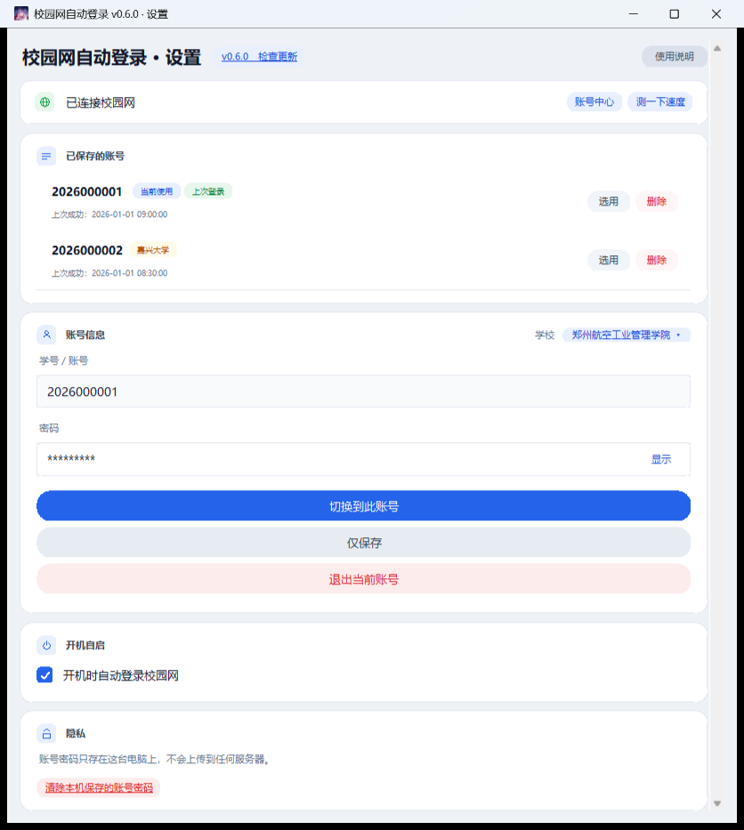

# 校园网自动登录

校园网自动登录是一个面向高校校园网认证门户的自动认证工具，提供开机自动认证、多账号切换、断线重连、密码框隐私保护与内置使用说明。目前内置两所学校的认证实现：**郑航（郑州航空工业管理学院）**与**嘉兴大学**（深澜 Srun）。

> 非官方项目，与学校网络管理部门无关。请仅使用你本人有权访问的账号，并遵守学校的网络使用规定。

当前版本 0.5.5，从 [Releases](../../releases) 或 [hobson2233.dpdns.org](https://hobson2233.dpdns.org) 下载，[历史版本](https://hobson2233.dpdns.org/history) 也都留着。



## 功能

- 开机自动认证，登录系统后自动联网，不用打开浏览器手动登录
- 多账号管理，一键切换，切换失败回滚到上一个可用账号
- 联网后继续守护 30 分钟，掉线自动重连，到点自动退出
- 状态区分「在校园网」与「能上网」，不在校园网时不报「已连接校园网」
- 密码框输入时只显示最后一位，可点按钮临时查看全文
- 点标题栏的版本号检查更新，下载中断自动重试
- 状态栏可测「到发布站的下载速度」，用来判断这台电脑能不能顺畅下载和更新
- 郑航用户可点状态卡上的「上网数据」，查看自己账号的状态 / 套餐 / 流量 / 时长 /
  在线设备（数据来自学校自助服务，**只读**；窗口关掉后不保存任何东西）
- 设置页可一键清除本机保存的账号密码与日志
- 使用说明内置于程序，不用另找文档
- 程序内不含账号密码，可直接分发给他人

## 运行环境

- Windows 10 / 11（x64）
- 单文件 exe，免安装，可放在任意目录运行，含中文或空格的路径均可
- 不需要管理员权限，不依赖 Python、VC++ 运行库或 .NET
- 磁盘占用约 12 MB

> 程序未进行代码签名，首次运行会触发 SmartScreen 提示，点击「更多信息」→「仍要运行」即可。

## 使用

双击运行，在「账号信息」那一行右边的下拉框里选学校，再填写学号与密码，点击「切换到此账号」。需要开机自动登录时，在设置页勾选「开机自启」。

账号与配置保存在 `C:\ProgramData\CampusLogin\`，不随程序文件移动。

## 换学校 / 适配其它学校

界面上的「学校」下拉框直接切换，选项来自源码里的 `SCHOOLS` 表：

| key | 学校 | 认证协议 |
|---|---|---|
| `zua` | 郑州航空工业管理学院 | `webauth`（门户表单） |
| `zjxu` | 嘉兴大学 | `srun`（深澜 Srun） |

加一所新学校 = 在 `SCHOOLS` 里加一项（外加对应的认证实现），**不用改别的代码**。

### 单项覆盖

选了学校之后，仍然可以单独覆盖某一项 —— 把要改的键写进数据目录里的 `config.json`（`C:\ProgramData\CampusLogin\config.json`）：

```json
{
  "school": "zua",
  "portalHost": "http://202.196.169.166",
  "wlanAcIp": "10.0.1.10",
  "wlanAcName": "ZZHK-ZAX-BRAS",
  "campusSubnets": ["10."],
  "triggerUrl": "http://1.1.1.1/",
  "loginExtra": { "pageid": "5", "templatetype": "1" }
}
```

- `school`：用哪套内置档案，默认 `zua`
- `portalHost`：认证门户地址，默认 `http://202.196.169.166`
- `wlanAcIp`：AC（接入控制器）地址，默认 `10.0.1.10`
- `wlanAcName`：AC 名称，默认 `ZZHK-ZAX-BRAS`
- `timeoutSec`：各项网络超时秒数，默认 `8`
- `campusSubnets`：校园网段前缀，用于判断是否在校园网，默认 `["10."]`
- `triggerUrl`：认证成功后跳转的目标，默认 `http://1.1.1.1/`
- `checkTargets`：连通性检测目标，格式 `[[url, 期望正文, 名字], …]`
- `loginExtra`：门户表单的公共字段，默认值见源码 `LOGIN_EXTRA`

⚠️ 程序**不会**把内置档案的值写回 `config.json` —— 写回去等于把默认值变成"你的配置"，之后换学校就换不过去了（`config.json` 里的键优先级高于学校档案）。切换学校时程序还会顺手清掉老版本留下的这类"固化键"。

更换学校时用浏览器开发者工具抓一次登录请求，把表单里的固定字段写进 `loginExtra`。写入的值类型不对、或写成空串与空表，一律退回默认值。

更换学校时用浏览器开发者工具抓一次登录请求，把表单里的固定字段写进 `loginExtra`。写入的值类型不对、或写成空串与空表，一律退回默认值。

## 隐私与数据

账号、密码与登录记录只写在本机 `C:\ProgramData\CampusLogin\`，该目录不可写时回退到 `%APPDATA%\CampusLogin\`。程序对外只访问学校认证门户与更新发布站 `hobson2233.dpdns.org`，没有统计、上报、崩溃收集或第三方接口。

清掉本机账号数据有两种方式：设置页最下面的「清除本机保存的账号密码」，或命令行 `校园网自动登录.exe --purge`。两者都会删除 `config.json`、`accounts.json`、`last-result.json` 与 `campus-login.log`，不可恢复。

README 截图中的学号与密码为演示数据。

## 构建

需要 Python 3.9 及以上版本（需带 tkinter）。

```
pip install pyinstaller pefile
python build.py
```

`build.py` 依次完成打包、冒烟测试、隐私检查与可移植性检查，任一步骤未通过则不出包，产物在 `repo/distN/`。

开发脚本、测试清单与发布流程见 [docs/DEVELOPMENT.md](docs/DEVELOPMENT.md)。

## 致谢与第三方项目

- [Python](https://www.python.org/)：运行时，随程序一同分发；PSF License。
- [Tcl/Tk](https://www.tcl.tk/)：界面库，随程序一同分发；BSD-style License。
- [PyInstaller](https://github.com/pyinstaller/pyinstaller)：将程序打包为单文件可执行程序；GPL-2.0-or-later，含允许打包专有程序的例外条款。

上述项目及其代码继续遵循各自的许可证，本项目的 MIT License 不替代其许可证。

## 免责声明

本项目按现状提供，不对可用性、准确性或使用结果作任何保证。部分学校禁止自动化认证脚本，使用前请自行确认，使用风险由使用者自行承担。

## 许可证

本项目采用 [MIT License](LICENSE)。
